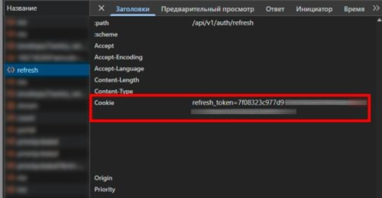
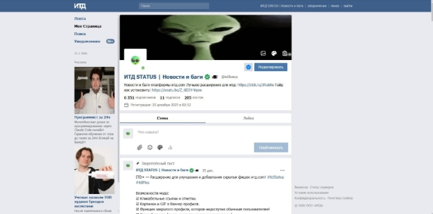

# ИТД2010
Локальная копия обновления **ИТД2010** на [итд.com](https://xn--d1ah4a.com), используя живое API сайта.
## Требования
- [Node.js](https://nodejs.org/) v18 или новее
-----
## Установка и запуск
### 1\. Клонируй репозиторий
git clone https://github.com/itdPlus/ITD-2010\
cd ITD-2010
### 2\. Получение refresh\_token
Это токен сессии на сайте. Он нужен единожды для входа в аккаунт.

1. Открой [итд.com](https://xn--d1ah4a.com/) в браузере и войди в аккаунт
1. Открой DevTools (F12)
1. Перейди во вкладку **Сеть,** и найди запрос **/refresh**
1. Пролистай ниже до значения refresh\_token и скопируй его в **config.js**

### 3\. **Открой config.js и вставь токен:**
module.exports = {\
`    `REFRESH\_TOKEN: 'сюда\_вставь\_свой\_токен',\
`    `PORT: 3000,\
};
### 4\. Запусти прокси
node proxy.js

Открой в браузере: **http://localhost:3000**

